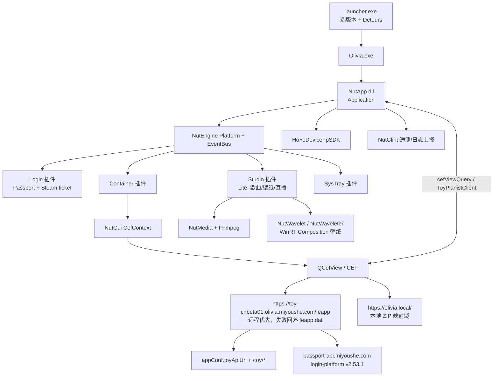

# BSide: Olivia Lin（Steam Beta 4532590）静态逆向分析报告

> 分析对象：`C:\Games\steam\steamapps\common\BSide Olivia Lin Test`（3.5 GB）
> 分析方式：纯静态（不运行目标、不改动安装目录），证据均来自文件字节、PE 结构、字符串与反汇编
> 分析时间：2026-10-26

---

## 0. 一句话结论

这是米哈游（miHoYo / HoYoverse）内部代号 **Olivia**（产品名 *BSide: Olivia Lin*，业务号 `game_biz=toy_cn`，客户端工程代号 **ToyPianist / toypianist**）的 Windows 桌面"陪伴/钢琴演奏"应用。它不是一个游戏，而是一个 **Qt6 外壳 + CEF 内嵌 Vue3 Web 应用 + 自研 Nut 引擎插件框架 + WinRT 合成层壁纸渲染进程** 的组合体：UI 全部在 Web 层，能力全部通过一条自研 JSON 桥下发给原生；数据面走米哈游 Passport 登录 + `toyApiUrl/toy/*` 业务接口，图像/音频重活交给 FFmpeg、MIDI 生成服务与 2.9 GB 预渲染 MP4 壁纸。

静态层面 **没有加壳、没有 VM 保护、符号未剥离**（大量 MSVC 修饰名与源码路径），可逆性非常好；唯一有难度的只有四处 `.dat` 文件的 AES 加密层。

---

## 1. 目录与产物清单

```
BSide Olivia Lin Test/
├── launcher.exe                 909 KB   版本选择/启动器（自身含 Microsoft Detours）
├── version.json                 5 个组件版本锚点
└── 0.0.9.627/                            当前生效版本目录（目录名 = 客户端版本）
    ├── Olivia.exe               576 KB   主入口；仅含 Detours + 引导逻辑
    ├── NutApp.dll             1.09 MB   应用层（Application / CEF 映射 / Dispatch）
    ├── NutBase.dll            5.48 MB   业务基座（配置/下载/用户设置/OpenSSL/WS2）
    ├── NutCommon.dll          4.10 MB   基础设施（日志/设备/GpuInfo/进程/JSON）
    ├── NutEngine.dll          655 KB    插件框架（Platform / EventBus / PluginModule）
    ├── NutGui.dll             588 KB    Qt 窗体 + CEF 上下文 + 容器桥
    ├── NutMedia.dll           927 KB    媒体：LRC 歌词、录音、视频元数据/缩略图/音量采样
    ├── NutGlint.dll           5.08 MB   遥测（EventTrack / LogReport）+ 静态 OpenSSL
    ├── NutWavelet.dll         1.93 MB   WinRT/Composition 壁纸宿主（全信任进程启动）
    ├── NutWaveleter.exe       1.98 MB   渲染侧独立进程（极简导入表）
    ├── NutCrashMon.exe        1.01 MB   崩溃收集
    ├── NutWPShlExt.dll        517 KB    Explorer 壁纸 Shell 扩展
    ├── NutUiKit.dll           224 KB    标题栏/窗口动画
    ├── QCefView.dll           2.01 MB   CEF 视图 Qt 封装（桥的宿主）
    ├── HoYoDeviceFpSDK.dll    899 KB    设备指纹 SDK（2025-04 构建，独立于主包）
    ├── Qt6*.dll               7 个       Qt 6.8（`qt_version_tag_6_8`）
    ├── av*/sw* (FFmpeg 7)     6 个       avcodec-61 / avformat-61 / avfilter-10 …
    ├── plugins/
    │   ├── Login/       NutLoginPlugin + NutLoginUI + NutLoginThirdparty + steam_api64
    │   ├── Container/   NutContainerPlugin + NutContainerUI（CEF 容器）
    │   ├── Studio/      NutStudioPlugin(5.9MB) + NutLiveChat + NutLivePlayer + NutWebPlayer
    │   └── SysTray/     NutSysTrayPlugin
    ├── resources/
    │   ├── feapp.dat          26.5 MB  → ZIP：主 Web 应用（Vue3）
    │   ├── webplayer.dat     120 KB    → ZIP：壁纸/播放器 Web 应用
    │   └── feplayer.dat       1.5 KB   → ZIP：单文件 <video> 播放器
    ├── assets/
    │   ├── songlist.dat       1.11 MB  AES 加密的歌单缓存
    │   ├── Wallpaper_Presence 2.9 GB   36 个 MP4（A/B 两套 × 3 档分辨率 + 过渡）
    │   └── Wallpaper_Ambience  89 MB   22 个环境音循环 mp3
    └── conf.app.dat           768 B    AES 加密的本地 AppConfig（含 DispatchUrl）
```

**编译时间戳**（UTC）全部集中在 **2026-08-12 09:43–09:51**，属同一流水线产物；`HoYoDeviceFpSDK.dll` 为 2025-04-11，是跨产品复用件。

**源码路径泄漏**（PDB 与 `__FILE__` 字符串，均为 GitLab Runner）：

```
D:\gitlab-runner\builds\cGLnFudTS\0\toypianist\toyclient_windowsapp\
    src\app\Main\src\App\Application.cpp
    src\app\plugins\Studio\StudioPlugin\PluginLogic\Lite\StudioManagerLite.cpp
    src\app\plugins\Studio\StudioPlugin\PluginLogic\Lite\SongDownloadManager.cpp
    src\app\plugins\Studio\StudioPlugin\PluginLogic\Lite\WebPlayer\WebPlayerManager.cpp
    src\base\Base\src\ConfigManager\AppConfig.cpp
    src\base\Base\src\DispatchClient.cpp
D:\Olivia\thirdpartylibs_desktop\build\vcpkg-src\buildtrees\boost-json\src\ost-1.86.0-…
```

→ 工程名 **toypianist/toyclient_windowsapp**，构建机 `cGLnFudTS`，第三方依赖走 **vcpkg + Boost 1.86**。

---

## 2. 架构



**分层与依赖方向**（由导入表证实，几乎教科书式分层）：

- `NutApp` → 只依赖 `NutBase/NutEngine/NutGui/NutGlint/NutUiKit/NutCommon`，不直接碰 Qt 细节；
- `NutBase` → 依赖 `NutGui(LanguageManager)`、`NutGlint(LogReport)`、`CRYPT32`、`WS2_32`，静态链 OpenSSL；
- `NutMedia/NutWavelet` → 只导出纯功能类，不依赖业务；
- 插件（`plugins/*`）→ 通过 `NutEngine::PluginModule` 注册进 `Platform`，用 `EventBus` 的字符串主题解耦。

`EventBus` 主题即跨模块契约，静态字符串已可见：
`app.singletonmessage`、`app.requestChangeRoute`、`container.feappinfo`、`container.window.statgechanged`、`container.window.systemResumed`、`studio.webPlayerWindowChanged`。

---

## 3. Web 前端（feapp.dat）

**不是加密包，就是标准 ZIP**，可直接解压（`ZipFile` 读出 36 个条目，解压后 38.7 MB）：

- Vue 3 + Element Plus + Vite 打包，产物 `main-31595bd3.js`（376 KB）+ `vendor-vue/vendor-element/vendor`；
- 中文字典 `zh-cn-bd81633d.js`；字体 `HanyiSentyGarden`(15.9 MB)、`SentyTEA`(5.4 MB)；
- 素材：`stamp_1..6`、`postcard_*`、`idle_normal/thinking/creative`、`home_idle` MP4、`mailbox-empty` 等；
- 构建标识（源码里 console.log 常驻）：`BUILD_VERSION = beta_cn_b776ad35_455e162`，与 `version.json` 的 `frontend-tp-beta_cn_b776ad35_455e162` 完全对应。

**路由（hash 路由，已被本机 CEF History 实证访问过）**：
`#/login`、`#/mode-select`、`#/collection`、`#/studio`、`#/history`、`#/settings`、`#/user-info`、`#/survey`、`#/feedback`、`#/share`
单页文档：`/single-pages/contentPage.html`（账号注销、PC 投诉指引、MIDI 上传指引、FAQ）。

**加载策略**（`Application::buildCefMappingUrl`）：
> `no remote base url available, use local mapping base url`

即：若 Dispatch 下发远程前端地址 → 直接加载 `https://toy-cnbeta01.olivia.miyoushe.com/feapp/index.html?ts=<毫秒戳>`；否则回落本地 ZIP，通过 `https://olivia.local/` 伪域映射挂载（`CefContext::setMappingBaseUrl`）。`webplayer.dat` 同理由 `/webplayer/index.html?uid=…&volume=100&muted=false` 访问。

`webplayer` 的 `index.html` 里还留了一份**开发用桥接 mock**，直接点明了桥的调用形态：

```js
window.ToyPianistClient.invoke(method, arg)
window.sendCmd({ cmd: "play", url: "..." })   // 调试入口
```

---

## 4. 桥接协议（最关键的逆向产出）

前端**没有**直接走 HTTP 拿系统能力，全部经由 **QCefView 的 CEF Query 通道**。链路：

```
JS: window.cefViewQuery({request, onSuccess, onFailure})
  → QCefView.dll: "cefViewQuery" / cefQueryRequest
  → NutGui::ContainerBridge → NutApp/插件 的 action 分发
```

两条互补通道：

### 4.1 请求/响应（`request` 是 JSON 字符串，含 `action` + `data`）

前端封装：`We(e) => new Promise(... window.cefViewQuery({request: JSON.stringify(e)}))`，
高频轮询类 action（`getSongDownloadProgress` / `getDownloadTasksProgress` / `sendWebPlayerControlCmd`）按 10% 概率才打日志。

共 32 个 action（含 5 个登录 SDK 内部伪 action）：

| 分组 | action |
|---|---|
| 配置/设备 | `getClientConfig`、`getSettings`、`updateSettings`、`getDeviceInfo`、`getThirdpartyLoginInfo`、`updateExtraHttpHeaders` |
| 窗口/进程 | `startClientApp`、`showFileDirectoryPicker`、`saveBase64File` |
| 歌曲/下载 | `startSongDownload`、`cancelSongDownload`、`getSongDownloadProgress`、`checkLocalSongs`、`getOfflineSongList`、`startDownloadTasks`、`cancelDownloadTasks`、`getDownloadTasksProgress` |
| 媒体 | `startMediaDownload`、`stopMediaDownload`、`checkLocalMedia`、`getMediaInfo`、`startMediaEdit`、`stopMediaEdit`、`saveMediaEdit` |
| 播放器 | `sendWebPlayerControlCmd` |
| 登录 SDK 内建 | `init_invoke/init_error`、`checkSToken_invoke/_response/_error`、`showThirdPartyQuickLoginPanel`、`init_missing_agreement_urls` |

### 4.2 单向命令 + 事件

`Ye(method, arg)` → `ToyPianistClient.invoke`（22 个）：

| 类别 | 方法 |
|---|---|
| 生命周期 | `exitApp`、`restartApp`、`minimizeWindow`、`hideWindow`、`notifyLogout` |
| 路由/UI | `updateRoute`、`updateMailReddot`、`openInBrowser`、`startChat` |
| 演奏 | `startSolo`、`startPlaysing`、`startInstrumental`、`ambienceEnded`、`sendRenderVolumeControl` |
| 收藏/播放 | `collectionPlay`、`collectionStop`、`addCollectionItem` |
| 外壳交互 | `openDirectory`、`revealFileInExplorer`、`eventTrack`、`toggleRenderLog`、`sendRenderConsoleMessage` |

`ToyPianistClient.addEventListener`（11 个原生 → Web 事件）：
`ambienceControl`、`collectionPlayDone`、`mediaDownloadProgress`、`mediaEditProgress`、`renderPlayerStatus`、`requestAppAction`、`requestChangeRoute`、`requestShowToast`、`systemResumed`、`uploadPerformance`、`webPlayerControl`。

> `renderPlayerStatus` / `mediaDownloadProgress` / `mediaEditProgress` 三个高频事件带 300 ms 节流（`fm=300`）。

---

## 5. 后端接口面

### 5.1 配置来源

`getClientConfig` 返回 `appConf`，字段结构已从前端默认值完整还原：

```json
{ "appConf": { "globalGatewayUrl":"", "otelAuthCredential":"", "otelService":"",
               "passportUrl":"", "webAccountHost":"", "region":"", "signSalt":"",
               "toyApiUrl":"", "toyWsUrl":"", "trackingUrl":"" },
  "appInfo": { "BundleId":"", "Channel":"", "ClientType":"", "Company":"",
               "ConfigVersion":"", "DisplayName":"", "Language":"", "Product":"",
               "ShowDebugPanel":false },
  "apiHeaders": {}, "deviceFP": "", "offlineMode": false }
```

`toyApiUrl` 来自原生侧 `Base::DispatchClient::getRemoteConfig` → `dispatcher/getAppConf`（配置体 AES 加密，见 §7），失败则"run without remote config"。

### 5.2 业务 API

axios 实例 `baseURL` 初始为空，配置到位后设为 **`appConf.toyApiUrl + "/toy"`**，`withCredentials: true`，超时 10 s。已提取 32 个端点：

| 方法 | 路径 | 语义 |
|---|---|---|
| POST | `/signIn`、`/editProfile`、`/getUserInfo`(GET) | 账号档案 |
| GET | `/getMusicTypeInfo` | 曲风/演奏模式元数据 |
| GET | `/getPreferenceSurvey`、POST `/submitPreferenceSurvey` | 偏好问卷 |
| GET | `/getSongStats` | 曲目统计 |
| GET | `/searchSongs`、`/searchPerformances`、`/searchPlaylist`、`/searchUserSongs` | 四类检索（PGC/UGC） |
| POST | `/addPerformance`、`/editPerformance`、`/delPerformance`、`/deleteUserSong` | 演奏作品 CRUD |
| POST | `/genObjectUploadUrl`、`/generateShareToken` | 对象存储直传 / 分享令牌 |
| POST/GET | `/letter/send`、`/resend`、`/share`、`/list`、`/detail`、`/unread_count` | "信件"系统 |
| POST | `/midi/generate`、`/cancelGenerate`、`/deleteJob`、`/importShareCode`；GET `/midi/listJobs`、`/getGenerateResult`、`/batchGetResult` | **服务端 MIDI 生成任务队列** |
| POST | `/addToPlaylist`、`/delFromPlaylist`、`/createFeedback` | 歌单、反馈 |

### 5.3 鉴权与请求头

- 业务会话头：`x-token: "toy__" + base64({aid, token})`，`x-uid`，`x-platform: pc_lite`（Lite 模式）；
- 设备头：`x-rpc-device_fp`、`x-rpc-device_id`、`x-rpc-device_name`、`x-rpc-device_model`、`x-rpc-device_os`、`x-rpc-client_type`；
- 渠道灰产位：`x-bw: 1`（当 `appInfo.Channel == "demo"`）；
- `signSalt` 存在 → 请求侧另有 HMAC 签名（盐在加密配置里，静态不可得）。

### 5.4 登录链路（本机 CEF 缓存实证）

| 项 | 值 |
|---|---|
| Web 源 | `https://toy-cnbeta01.olivia.miyoushe.com` |
| `game_biz` / `app_id` | `toy_cn` / `falmx90w5slc` |
| 登录 SDK | miHoYo passport `login-platform-for-hyp` **v2.53.1**（build `v2.53.1-641bebdd`），`client_type=3` |
| 关键端点 | `/account/ma-cn-passport/app/loginByPassword`、`loginByMobileCaptcha`、`createQRLogin`/`queryQRLoginStatus`、`loginByThirdparty`；`/account/ma-cn-session/app/exchange`、`verify`、`createCrossLoginToken`；`/account/ma-cn-verifier/verifier/*`；`/oauth2/v1/token`；风控 `/common/aigis/api/checkSmartCaptcha` |
| 用户中心 | `https://user.miyoushe.com/login-platform/index.html?app_id=falmx90w5slc&game_biz=toy_cn&theme=toy…` |
| Steam 第三方 | `plugins/Login/NutLoginThirdparty.dll`：`initialize(appid)` / `getAuthTicket` / `setAuthTicketHandler` / `getNickname`，配合 `steam_api64.dll` 取 AuthSessionTicket 换取米哈游会话 |

> 本机 `%APPDATA%\miHoYo\Olivia-steam\cache\web\Default\Local Storage\leveldb` 中确有该账号的 `stoken`/`mid`/`aid` 明文（SDK 日志字段）。**本报告不复述任何令牌值**，如需清理请自行登出或删除该目录。

---

## 6. 原生能力拆解

### 6.1 播放/壁纸

- `WebPlayerManager`（Studio 插件）：`webplayer.dat` → CEF 播放页，`playVideo` 解析 `videoUrl` 并落到 `UGC video directory`；`IdleManager::scanAvailableRoutines` 扫描 `assets/Wallpaper_Presence`，失败文案 `No routines found for `、`Unknown idle view mode`。
- 壁纸命名规律：`{A|B}_R{1..3}_{1200|1730|2000}.mp4` + `{A|B}_Transition_{from}_{to}.mp4` → **两套人物状态 × 3 档竖屏高度 × 相互过渡**，与 `Wallpaper_Ambience/ambient_loop_N.mp3`（22 条）交叉淡入，事件 `ambienceControl`、`setMute`。
- `NutWavelet.dll` 用 `Windows.UI.Composition` + `Windows.Media.*` + `FullTrustProcessLauncher` 把视频贴到桌面层，`NutWaveleter.exe` 是它的极简宿主进程（只导入 KERNEL32/USER32/SHELL32）。
- `NutWPShlExt.dll`：Explorer 右键"设为壁纸"类 Shell 扩展。

### 6.2 媒体处理（NutMedia）

导出表直读：`Media::Lyrics`（`parseFile/parseStream/parseString`、`lineAtOffset`、`offsetToIndex`、`kEndTimeNever` → 标准 LRC）、`Media::AudioRecorder`、`Media::VideoProcessor`（`getMediaMetaData`、`getMultipleThumbnailsBase64`、`getVolumeSamplesFromVideoFile`）。底层即同目录 `avcodec-61/avformat-61/avfilter-10/swscale-8`（FFmpeg 7.x）。

### 6.3 MIDI 生成

前端 `/midi/*` 六个接口说明生成在服务端；客户端侧流程为：`genObjectUploadUrl` 拿直传地址 → 上传 → `midi/generate` 建任务 → `listJobs`/`batchGetResult` 轮询 → `importShareCode` 导入分享码。`NutStudioPlugin` 内有独立的 `SongDownloadManager`（断点、失败清理 `clearing failed tasks for song:`）与 `downloadCoverImage`（HTTP 状态码校验）。

### 6.4 外壳

- 单实例：`app.singletonmessage`、`Application::onSingletonMessage`、`Received singleton message:`；
- 托盘：`NutSysTrayPlugin` + `zh-cn.json/en-us.json` 文案（`product_name: "Olivia"`、`tray_action_exit/open`）；
- AppUserModelId 注册 + 固定到任务栏快捷方式刷新（`RefreshWindowAppUserPinnedShortcut`）；
- 自重启：`restartArgs`、`Self process restarted successfully, pid:`；
- 启动画面：Qt 资源 `:/app/forms/SplashScreen.ui`、`:/app/images/piano_loader.webp`。

---

## 7. 数据格式与加密层（唯一"硬"的地方）

| 文件 | 形态 | 结论 |
|---|---|---|
| `feapp.dat` / `webplayer.dat` / `feplayer.dat` | **纯 ZIP**（`PK\x03\x04`，deflate/store） | 直接解压，无签名、无清单校验 |
| `conf.app.dat`（768 B） | 密文，熵 8.0，16 字节对齐 | `Base::Details::ConfigFileLoader::LoadEncryptedConfig` |
| `songlist.dat`（1,162,480 B = 72,655×16） | 密文，熵 8.0，无周期性 | `StudioManagerLite::getOfflineSongList` → 解密失败文案 `failed to decrypt list dat.` |
| `appstore.dat` / `usersettings.dat` / `eventtrack.dat` | 同族命名 | 同类加载器（用户目录下 `store/`、`logs/` 当前为空，未生成） |

`NutBase.dll` 与 `NutGlint.dll` 均**静态链接 OpenSSL**（`EVP_EncryptUpdate/EVP_DecryptFinal_ex/aesni_*_init_key/hmac` 等符号齐全），`DispatchClient::decryptConfig` 与 `Failed to decrypt enc_conf` 表明下发配置本身就是密文信封。

### 已定位到的解密调用点（可直接下断点）

在 `plugins/Studio/NutStudioPlugin.dll`（ImageBase `0x180000000`）中，字符串 `failed to decrypt list dat.` 只有一个 RIP 相对引用，位于：

```
0x15cf61  (rva)   引用该字符串
0x15cd12  lea rdx, [rbp+0x100]      ; 文件名
0x15cd19  cmp qword [rbp+0x118], 7  ; std::string SSO 判定
0x15cd21  cmova rdx, [rbp+0x100]    ; → 实际指针
0x15cd29  mov dword [rsp+0x20], 1   ; 第 5 参 = 1
0x15cd31  mov r9d, 0x40             ; 64
0x15cd37  mov r8d, 0x20             ; 32
0x15cd44  call 0x105e80             ; 模板化加载器 ctor(out, path, 0x20, 0x40, 1)
```

`0x105e80` 内部随即以 `(path, 0x20|1 = 0x21, 0x40)` 调用 **`0x10af40`**，后者是 boost::iostreams 风格的"文件流 + 解密过滤器"装配函数（`0x10af40` 里 `[rcx+0x80]` 为句柄位、`[rbx+0x68]` 为流指针，失败统一返回 0）。

**参数语义推断**：`0x20 = 32` 字节密钥（AES-256），`0x40 = 64` 为头部/块参数，第 5 参 `1` 为"是否需要密钥校验/是否流式"。要落地解密，最快路径是动态取密钥（见 §9），而不是静态还原 OpenSSL 调用链。

---

## 8. 安全、隐私与可改性评估

**遥测/隐私采集面**（均为默认开启、无独立开关证据）：

| 组件 | 行为 |
|---|---|
| `HoYoDeviceFpSDK.dll` | DXGI/D3D11 取显卡与分辨率、`GetAdaptersInfo` 取网卡、注册表、计算机名、内存、系统版本、前台窗口；`CryptEncrypt/CryptHashData` 本地封包；`WinHttp*` 走 IE 代理上报 |
| `NutGlint` | `EventTrack::Track` + `LogReport`，落盘 `eventtrack.dat`；前端把每次桥调用、每个 UI 事件都打点（`BRIDGE_INVOKE`/`BRIDGE_QUERY`/`BRIDGE_EVENT_HANDLER`/`ACCOUNT_SDK`） |
| 前端 OTel | `serviceName = "web_toy_log_pc"`，`endpoint = appConf.otelService`，`Authorization = otelAuthCredential`，公共字段直接带 `x-uid` |
| `eventTrack` / `trackingUrl` | 业务埋点独立通道（`songPlayStart/songPlayEnd/songDownload/songBatchDownload*` 等） |
| 崩溃 | `NutCrashMon.exe` + `%APPDATA%\miHoYo\Olivia-steam\crash` |

**可改性判断**：

- ✅ **前端可改**：`feapp.dat` 是普通 ZIP，改完重新 zip（保持 `index.html` 在根、无压缩校验）即可被 `https://olivia.local/` 直接加载；调试面板本身留了后门——**设置页 3 秒内连点 10 次**触发 `ShowDebugPanel`（需 `appInfo.ShowDebugPanel` 为真）。
- ⚠️ **原生层未加壳**：可随意静态/动态分析；`Olivia.exe` 自带 **Microsoft Detours**（节区 `.detourc/.detourd`）并申请 `SeDebugPrivilege` 类权限（`OpenProcessToken`+`AdjustTokenPrivileges`+`LookupPrivilegeValueA`），说明它自己就在做 API Hook——这是排查"为什么改了没用"的第一嫌疑点。
- ❌ **配置/歌单不可直接读**：`conf.app.dat`、`songlist.dat` 走 AES 信封，需要运行时密钥。
- ⚠️ **签名**：所有原生模块为 DigiCert EV 代码签名（`DigiCert Trusted G4 Code Signing RSA4096 SHA384 2021 CA1` + RFC3161 时间戳）；改 DLL 会破坏签名（是否强校验未验证）。

---

## 9. 下一步（可直接执行的路线）

**A. 解密 `songlist.dat` / `conf.app.dat`（推荐，成本最低）**
1. 用 x64dbg 附加 `Olivia.exe`，在 `NutStudioPlugin.dll+0x10AF40`、`+0x105E80` 下断（首次进入"离线曲库"页时命中）；
2. 断在 `0x10afda`（装配过滤器前）——密钥与 IV 已在栈/寄存器上或已传入成员，直接 dump 32 字节；
3. 判型：密文长度严格 16 对齐且无 IV 前缀 → 多为 AES-256-CBC（IV 常硬编码）+ PKCS#7；若解出首字节是 `[`/`{` 即命中，`songlist` 应为 JSON 数组（`id/name/nameKey/styleType/iconUrl/duration/videoUrl`，与前端字段完全对应）。

**B. 观察桥流量**
启动参数追加 CEF 开关（`--remote-debugging-port=9222`）即可用 Chrome DevTools 看 `feapp` 的 Console/Network；或直接在 `webplayer` 页面用现成 mock：`sendCmd({cmd:"play", url:"..."})`。

**C. 抓 API 实际基址**
在 `getClientConfig` 返回处下断（`NutBase!AppConfig::Data`），或断 `jl(baseURL, headers)` 对应的前端 `appConf` 赋值；也可从 leveldb 的 `request_config` 键反推。
抓包时注意 `x-token`/`stoken`、`signSalt` 派生签名，离线复现请求需同步设备指纹头（`x-rpc-device_fp` 来自 `HoYoDeviceFpSDK`）。

**D. 壁纸/素材**
`Wallpaper_Presence/*.mp4` 与 `Wallpaper_Ambience/*.mp3` 是明文，无需解密；字号/花体字素材在 `feapp/assets/*.ttf`。

---

## 10. 本次产出的文件

| 路径 | 说明 |
|---|---|
| `.tmp/bside/feapp/` | `feapp.dat` 解包（Vue3 全部源码级产物、字体、视频、贴图） |
| `.tmp/bside/webplayer/`、`feplayer/` | 另两个 ZIP 解包 |
| `.tmp/bside/REPORT.md` | 本报告 |
| `.tmp/bside/bridge-protocol.json` | 桥协议机读版（actions / methods / events / endpoints / headers） |
| `.tmp/bside/pe.py` `dasm.py` `scan_rip.py` `str2.py` `xref.py` `exports.py` | 自写 PE 解析 + capstone 反汇编 + RIP 引用扫描工具链（可复用） |
| `.tmp/bside/*.clean.txt` / `*.str.txt` | 各模块清洗后的字符串库 |

> 说明：本报告只做静态事实描述与可逆性评估，涉及账号令牌的部分已主动省略；未对安装目录做任何写操作。
